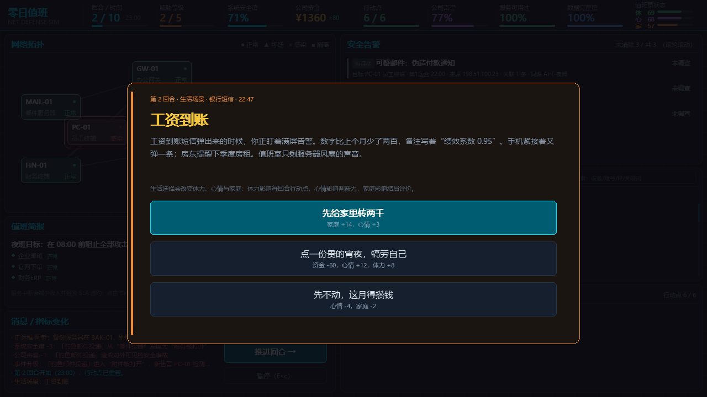
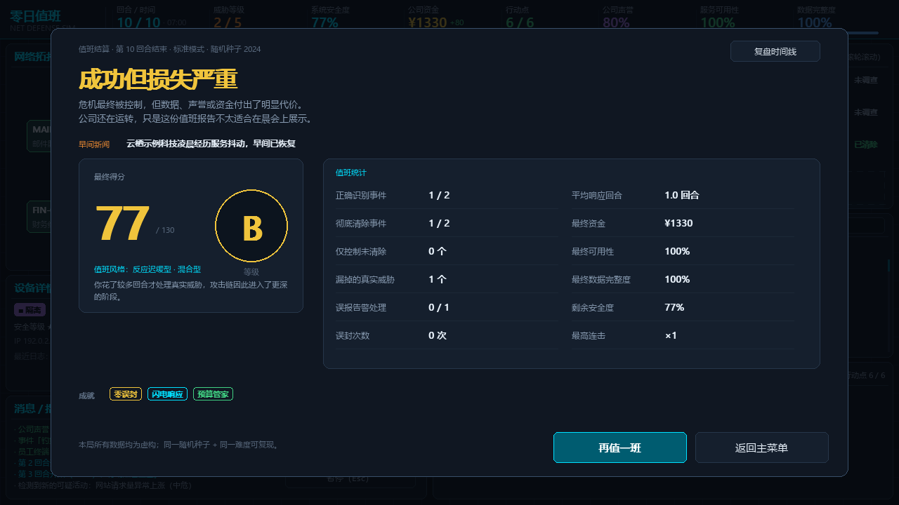

# 零日值班：网络安全防御模拟器

> 22:00 交接，08:00 早会。  
> 你是「云栖示例科技」今晚唯一的安全值班员。  
> 10 个回合、6 条攻击链、有限的预算——守住公司，也守住业务。  
> 还有你自己的体力、心情和家庭。


## 安全声明

- 本项目是单机游戏与课程演示，不是真实的安全工具。
- 不扫描真实网络、不连接真实服务器、不执行系统命令、不包含恶意代码。
- 游戏不提供现实攻击步骤。
- 所有 IP、账号、域名、服务器均为虚构数据，示例 IP 使用文档保留地址段。

## 今晚发生了什么

公司刚刚完成一次业务上线，夜里只剩你一个人值班。

监控平台不断产生告警：钓鱼邮件、异常登录、模拟勒索、Web 流量异常、内部账号批量访问，以及第 8 回合出现的零日漏洞。它们不是孤立的——其中 5 条分属两个攻击者：

- **APT-夜鸦**：从一封伪造付款邮件开始，偷凭据、走内网、批量导出数据。它偏好你没调查的入口；当你隔离了太多设备，它会降低活动强度，等你放松。
- **灰烬漏洞团伙**：盯着对外 Web 资产，偏好在线、未打补丁的高价值设备。目标被隔离或修复后，它会转向，但转向前会留下探测线索。

每回合你只有 **6 点行动点**。调查、控制、清除、恢复——顺序错了，公司要么被攻击打穿，要么被你自己关停。

## 一局怎么玩

每个回合按同一个循环推进：

1. **调查**：告警调查前只显示「待评估」。调查后才能看到真实等级、线索、风险区间和下一跳。
2. **控制**：隔离设备、封禁来源、关闭服务。攻击暂时停住，但根因还在。
3. **清除**：删除邮件、重置凭据、安装补丁、清除威胁。根因移除后，告警才会关闭。
4. **恢复**：解除隔离、启动服务、从备份恢复。业务停着的时候，收入、声誉和可用性一直在掉。

**控制不等于解决，清除也不等于恢复。** 这是整局游戏最常犯的三个错误。

还有一条**生活线**：每回合开始，你的体力、心情和家庭都会被夜班消耗一点。体力不够，行动点会变少；心情太差，风险估计会变宽；家里太久没人管，结算时会多一句不好听的话。

## 操作

### Windows 桌面版

| 操作 | 方式 |
| --- | --- |
| 选择设备 / 查看告警 | 点击左侧拓扑节点或右侧告警 |
| 执行处置 | 点击底部操作面板 |
| 推进回合 | `空格` |
| 暂停 / 存档 | `Esc` |
| 快速保存 / 读取 | `F5` / `F9` |
| 安全加固商店 | `U` |
| 值班手册 | `F1` |
| 音效开关 | `M` |

### 网页版

| 操作 | 方式 |
| --- | --- |
| 选择目标 / 执行处置 | 点击，或选中目标后按数字 `1–6` |
| 处置终端 | `` ` `` / `~`，支持 `scan PC-01`、`isolate PC-01` 等命令 |
| 自动化剧本 | `C`，可用 `for` + `alerts()` 批量处置，支持单步运行 |
| 推进回合 | `空格` |
| 暂停 / 手册 / 加固 | `Esc` / `F1` / `U` |
| 快速保存 / 读取 | `F5` / `F9` |

网页版支持桌面、平板和手机；同一随机种子 + 同一难度可以复现同一局。

## 三档难度

难度只改变信息质量、提示和容错，不直接增加攻击伤害。

| 难度 | 你会得到什么 | 你要自己判断什么 |
| --- | --- | --- |
| **新手** | 完整处置建议、精确下一跳、更窄的风险区间；关键误操作前提示一次 | 是否执行、先救哪条业务 |
| **标准** | 证据、风险区间和处置方向 | 完整操作顺序、具体设备 |
| **专家** | 证据与风险；部分日志延迟一回合；线索可能互相冲突 | 几乎所有东西，且误封代价更高 |

## 十二种操作

| 操作 | 主要作用 | 代价 / 条件 |
| --- | --- | --- |
| 调查告警 | 揭示线索、收窄风险区间 | 1 AP · ¥20 |
| 删除可疑邮件 | 早期钓鱼事件可直接阻断 | 1 AP · ¥10；后期无效 |
| 重置账号密码 | 清除凭据类事件根因 | 1 AP · ¥35 |
| 封禁来源 IP | 切断外部通道并控制事件 | 1 AP · ¥25 |
| 隔离设备 | 控制该设备上的攻击链 | 2 AP · ¥30；业务中断 |
| 解除隔离 | 恢复业务 | 1 AP；未清除事件会重新活跃 |
| 清除威胁 | 删除已控制事件的根因 | 2 AP · ¥60 |
| 安装安全补丁 | 阻断 Web / 零日早期阶段 | 1 AP · ¥45；维护期服务降级 |
| 关闭服务器 | 强行控制设备攻击链 | 2 AP；服务中断，误关扣声誉 |
| 启动服务器 | 恢复业务 | 1 AP；未清除事件会重新活跃 |
| 从备份恢复 | 恢复数据完整度 | 2 AP · ¥90；需要备份 |
| 保护备份服务器 | 降低勒索最终损失 | 1 AP · ¥70；仅 BAK-01 |

## 三条加固路线

在暂停菜单或按 `U` 打开加固商店。三条线各两层，第二层三选一：

| 路线 | 第一层 | 第二层专精 | 适合的玩法 |
| --- | --- | --- | --- |
| **情报** | 日志关联分析插件：置信度提升、调查更便宜 | 威胁情报订阅：额外线索、更早识别同源战役、推断下一跳 | 先看清再动手 |
| **响应** | EDR / 自动封禁剧本：隔离或封禁更省 AP | 自动化处置剧本：清除更快，但误封关键设备额外扣声誉 | 用资源换速度 |
| **韧性** | 离线备份：备份恢复更强、勒索损失减半 | 多线路与 SLA 缓冲：收入加成、声誉缓冲、业务降级收入下限 | 接受损失，保住业务 |

## 值班之外：生活线

夜班只有你一个人。除了告警，还有工资短信、老板的语音、家里的视频、窗外的雨。

| 生活数值 | 初始 | 每回合消耗 | 低了会怎样 |
| --- | --- | --- | --- |
| **体力** | 72 | −3 | 体力 < 55 行动点 −1；< 30 再 −1（最低 3） |
| **心情** | 70 | −2 | 心情 < 40 时调查置信度 −10%，风险区间变宽 |
| **家庭** | 60 | −3 | 家庭 ≤ 25 触发「没守住家」的结算评语 |

第 2、3、6、9、10 回合会插入 5 个生活场景：

- **工资到账**：先给家里转钱、点份贵的宵夜，还是这月先攒着
- **老板在群里发火**：如实汇报、拍胸脯保证，还是顶回去
- **家里打来了视频**：接三分钟、挂掉，还是开着视频一边陪孩子一边处置
- **天快亮了，外面在下雨**：打车回家睡两小时、在工位趴二十分钟，还是硬撑到早会
- **07:40 的早会**：全说、只说漂亮的部分，还是先道歉再补一份复盘



选项上只写直接成本。生活分 =（体力 + 心情 + 家庭）/ 3，会以约 −7 ~ +5 计入总分；结算页单独列出生活状态与评语，也会影响两个生活成就。

## 三个剧情决策

第 4、5、7 回合会出现需要你承担后果的选择：

- **客户施压**：关闭接口排查，还是保持在线？
- **高风险服务窗口（三选一）**：立即关停、限流观察，还是保持在线集中调查？
- **媒体询问**：主动披露，还是暂不回应？

选项上只显示你能预知的直接成本。安全与业务影响可能立即发生，也可能在 **1–3 回合后**才结算；结算界面会解释这些延迟后果。


## 六个结局

| 结局 | 触发条件 |
| --- | --- |
| **完美防守** | 所有真实威胁彻底清除，业务与数据保持完整，零误封 |
| **成功但损失严重** | 活到 08:00，但数据、声誉、可用性或资金付出明显代价 |
| **数据泄露** | 数据外泄，或数据完整度 ≤ 20 |
| **模拟勒索软件失控** | 勒索软件完成最终阶段且备份未生效 |
| **过度防御导致业务崩溃** | 可用性连续 3 回合 ≤ 40 |
| **安全体系崩溃** | 安全度归零，或管理员权限失守 |

结算会给出得分、等级、处置统计、误封次数、玩家风格和 **真实事件时间线**：关键正确处置、最大失误、无效操作、误封损失，以及最危险但被你阻断的攻击。



## 本次更新（v1.9.0）

这一版加的是**人**。值班员不是机器，一晚上除了告警，还有工资、老板、家人和天亮之后的早会。

| 改动 | 之前 | 现在 |
| --- | --- | --- |
| **生活线** | 只有安全与业务指标 | 顶栏新增「值班员状态」：体力 / 心情 / 家庭 三条生活数值 |
| **体力** | 行动点固定 6 | 体力 < 55 行动点 −1，< 30 再 −1（最低 3）；休息能回体力 |
| **心情** | 只影响叙事 | 心情 < 40 时调查置信度 −10%，风险区间变宽 |
| **家庭** | 不影响任何东西 | 家庭 ≤ 25 触发「没守住家」的结算评语；家庭 ≥ 70 且体力 ≥ 50 会有另一种结算评语 |
| **生活场景** | 一夜只有告警和 3 个剧情决策 | 第 2/3/6/9/10 回合插入 5 个生活场景：工资到账 / 老板发火 / 家里视频 / 天亮回家 / 早会 |
| **结算** | 只有安全、业务与资金 | 新增生活区块、生活分与两个生活成就（生活还在 / 只赢了公司） |
| **规则不变** | — | 攻击链、难度、加固、随机种子全部不变；生活逻辑不消耗随机数，同一种子仍复现同一局 |

### 上一版（v1.8.0）

两轮“体验包”都只改**看得见的东西**：规则、数值、存档与随机复现不变，同一种子仍然复现同一局。

| 改动 | 之前 | 现在 | 版本 |
| --- | --- | --- | --- |
| **禁用按钮写原因** | 只在悬停提示里，触屏永远看不到 | 按钮第二行直接写「请先调查告警」「AP 不足（需要 2 点）」 | 网页 + 桌面 |
| **不可逆动作二次确认** | 误点「解除隔离」「关闭服务器」当场生效 | 第一次点击只上橙框、写「再点一次确认」，4 秒不确认自动取消 | 网页 + 桌面 |
| **零星告警时的空态** | 告警面板下半截一大片空黑 | 「监控持续运行 · 已清除 N 条 · 下一个巡检点」+ 扫描光 | 网页 + 桌面 |
| **字号层次** | 时间戳和正文一样大 | 正文保持原尺寸，时间戳与分类退到左列、小一号 | 网页 + 桌面 |
| **回合结算摘要** | 推进回合后数字直接跳变 | 1.7 秒摘要：指标变化 / 新增告警 / 哪条链推进到哪一步 + 一行下回合预警 | 网页 + 桌面 |
| **夜色与整点** | 时钟只出现在顶栏 | 夜色随时钟走（22 冷蓝 → 03 最沉 → 06 回温）；22/01/04/07 点各一次整点节拍 | 网页 + 桌面 |
| **趋势预判** | 系统安全度只是一个百分比 | 数字旁写「03:00 失守」，快到期转红 | 网页 + 桌面 |
| **失败预兆** | 到结算才知道自己要输 | 连续两回合可用性不足 40% 时，画面发灰、边缘红光呼吸 | 网页 + 桌面 |
| **动作音色** | 所有“做对了”都是同一个音 | 调查＝键盘两声、隔离＝咔哒断电、清除＝扫频、恢复＝电流回升 | 网页 + 桌面 |
| **反馈改内联** | 「调查成功」盖在屏幕中央，正好压住日志 | 结果写进操作面板提示行，粒子只炸在目标位置 | 网页 + 桌面 |
| **损失具象** | 掉血只是数字变了 | 指标闪一下并从旧值滚到新值，业务行掉线红一下，隔离的连线真的断开 | 网页 + 桌面 |
| **误封有个人** | 误封只剩一句「声誉 -5」 | 每台设备有业务负责人，误封时他会带着一句话来投诉，并写进复盘时间线 | 网页 + 桌面 |

## 开始游戏

- **网页版（v1.9.0）**：[在线试玩](https://telling890.github.io/zero-day-duty/play/)
- **Windows 免安装版**：[下载最新 Release](https://github.com/telling890/zero-day-duty/releases/latest)
- **从源码运行**：Python 3.10+、Pygame；在项目目录执行 `py -3.10 main.py`

### 桌面便携版（Electron，自带 Chromium）

单文件 exe，目标电脑**不需要 Python、不需要 WebView2、不需要联网**；插 U 盘就能在不同 Windows 电脑上演示。

- 和网页版**同一套 UI**：处置终端、自动化剧本、生活线、16 页教程、主题全部一致；
- 约 105 MB，首次启动先解压，之后正常开窗；
- 存档写在 exe 同目录的 `saves` 里。

```powershell
cd desktop_electron
npm install
npx electron-builder --win portable --x64
# 产物：release\零日值班-便携版.exe（复制/改名为 ZeroDayDuty.exe）
```

源码入口：`desktop_electron/`（`main.js` + `package.json`）；网页版更新后重新执行上面的构建即可同步。
> 旧的 WebView2 方案仍保留在 `desktop_webview.py` / `build_webview.ps1`，但交付以 Electron 便携版为准。

> 游戏内所有公司、人物、账号、IP 与事件均为虚构。  
> 它的目标是让你理解防御决策的取舍，而不是教你攻击。
