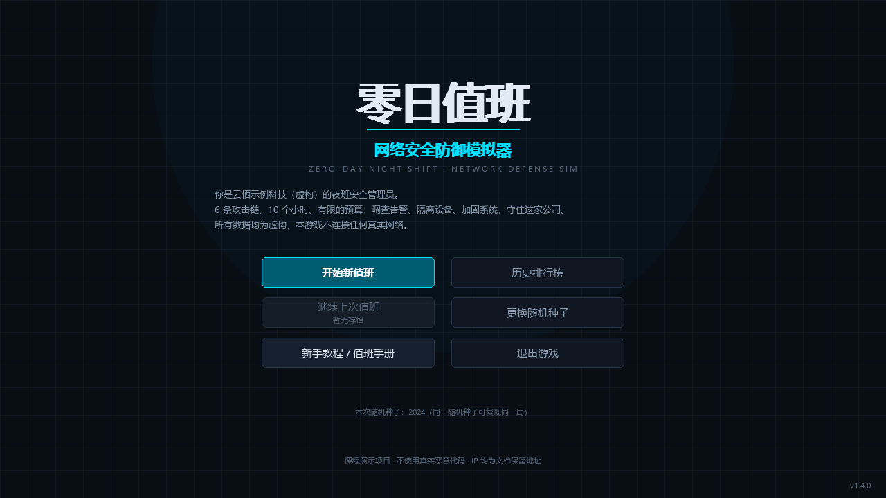
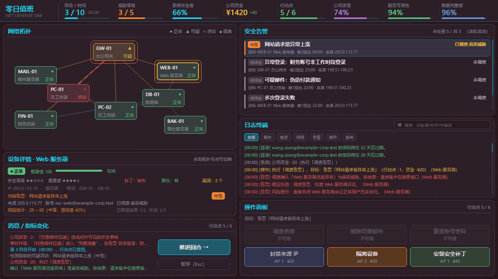
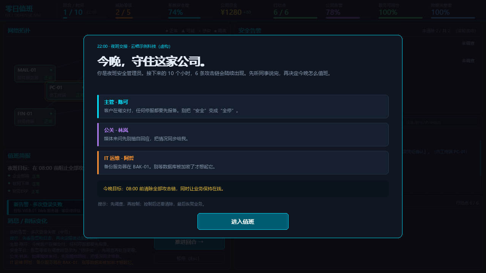
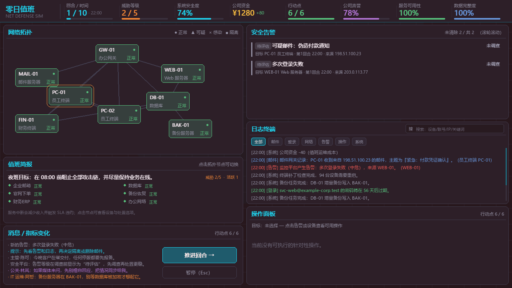
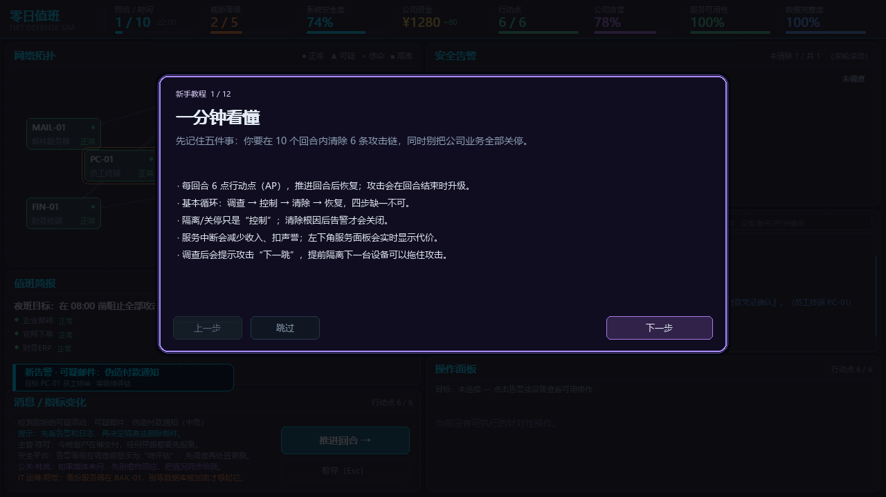
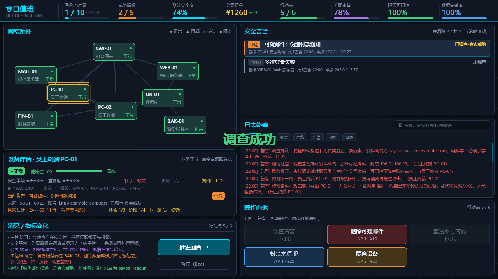
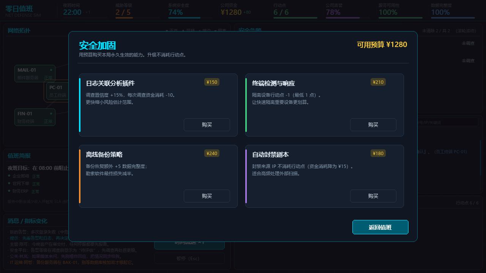
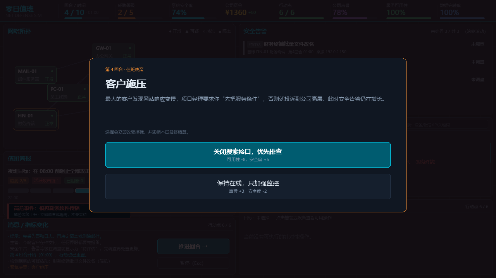
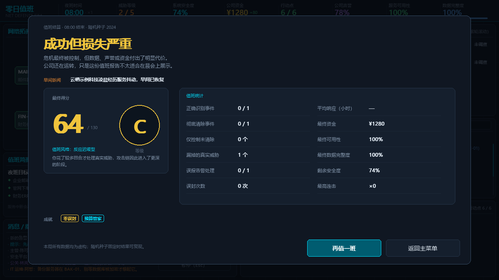

# 零日值班：网络安全防御模拟器

[](https://github.com/telling890/zero-day-duty/actions/workflows/tests.yml)
[](https://github.com/telling890/zero-day-duty/releases)
[](https://telling890.github.io/zero-day-duty/)

一个使用 **Python 3.10+ / Pygame** 编写的中文单机网络安全防御模拟游戏，适合 Python 课程作业与课堂展示。

玩家扮演虚构公司「云栖示例科技」的夜班安全管理员。10 个小时、6 条攻击链、有限的行动点和预算：读日志、查告警、隔离设备、打补丁、恢复备份、做公关决策，让公司在早会前活下来。

> **安全声明**
>
> - 本项目只做游戏模拟与课程展示。
> - 不扫描真实网络、不连接真实服务器、不执行真实系统命令、不包含真实恶意代码。
> - 游戏不提供现实攻击步骤。
> - 所有 IP、账号、域名和服务器均为虚构数据。
> - 示例 IP 使用 `192.0.2.0/24`、`198.51.100.0/24`、`203.0.113.0/24` 等文档保留地址段。


















> Windows 免安装版：[下载 v1.4.1 Release](https://github.com/telling890/zero-day-duty/releases/latest)（`ZeroDayDuty-Windows-x64.zip`），解压后双击 `零日值班.exe`，无需安装 Python。
> 源码仓库：[github.com/telling890/zero-day-duty](https://github.com/telling890/zero-day-duty)
> 项目主页：[telling890.github.io/zero-day-duty](https://telling890.github.io/zero-day-duty/)

---

## 一、运行环境

| 项目 | 要求 |
| --- | --- |
| 操作系统 | Windows 10 / 11（源码版也可在其他系统运行，中文字体查找以 Windows 为主） |
| Python | 3.10 及以上 |
| Pygame | 2.1 及以上（开发验证使用 2.6.1） |
| 分辨率 | 1280 × 720，窗口固定大小 |
| 编码 | 全部源码与 JSON 使用 UTF-8 |

除 Pygame 外只使用 Python 标准库（json / random / pathlib / dataclasses / array / math 等）。

## 二、安装与启动（源码版）

在 `cyber_defense_game` 目录下打开 PowerShell：

```powershell
# 1. 安装依赖
py -3.10 -m pip install -r requirements.txt

# 2. 启动游戏（数据目录相对 settings.py 定位，可从任意目录运行）
py -3.10 main.py

# 3. 固定随机种子，复现同一局
py -3.10 main.py --seed 2024
```

如果 `python` 已经指向 3.10+，也可以直接：

```powershell
python -m pip install pygame
python main.py
```

## 三、操作说明

| 操作 | 方式 |
| --- | --- |
| 选择设备 | 点击左侧网络拓扑中的节点 |
| 查看告警 | 点击右侧告警列表中的一行 |
| 调查 / 处置 | 点击底部「操作面板」中可用的按钮 |
| 推进回合 | 点击「推进回合 →」或按空格 |
| 暂停 / 存档 | `Esc` 暂停；暂停菜单可保存、读取、重开、回主菜单 |
| 快速保存 / 读取 | `F5` / `F9` |
| 安全加固商店 | `U` 或暂停菜单「安全加固」 |
| 音效开关 | `M` |
| 值班手册 | `F1` |
| 日志过滤 | 点击「全部 / 邮件 / 登录 / 网络 / 告警 / 操作 / 系统」标签 |
| 日志搜索 | 点击右上角搜索框输入关键词（英文、数字最稳定） |
| 日志 / 告警滚动 | 鼠标悬停在对应区域，滚轮上下滚动 |

## 四、v1.4.1 已实现内容

- Pygame 窗口、主菜单、12 页新手教程 + 6 步实战演练、暂停、帮助手册、结算、安全加固商店、历史排行榜、剧情决策浮层
- v1.4 正确反馈：操作后屏幕右下显示“调查完成/控制成功/清除成功/恢复完成”，并标出所处阶段
- 12 页新手教程 + 6 步完整演练：调查 → 控制 → 清除 → 恢复 → 推进回合
- 夜班交接简报、角色留言、早间新闻、低频环境底噪、服务中断播报
- 三段式响应：**控制 → 清除 → 恢复**；隔离/关停只完成控制，事件不会自动结束
- 业务服务与 SLA：企业邮箱、官网下单、财务 ERP、数据库、备份、办公网；服务中断会减少收入并扣声誉
- 攻击下一跳预测：调查后可预判下一台受影响设备，提前隔离可以拖住攻击
- 情报关联：同源 IP / 同账号告警会在列表和日志中提示关联数量
- 深色 SOC 监控中心界面：状态栏、拓扑、设备详情、告警卡片、日志终端、操作面板、消息区
- 8 台虚构设备与邻接表拓扑；攻击链沿设备关系推进
- 6 条攻击链 + 3 类误报告警：
  - 钓鱼邮件投递（4 阶段）
  - 异常登录（3 阶段）
  - 模拟勒索软件传播（3 阶段）
  - Web 服务器流量异常（3 阶段）
  - 内部账号异常访问（3 阶段）
  - 第 8 回合的零日漏洞利用（3 阶段 BOSS）
- 事件顺序使用随机种子打乱（首回合教学事件和第 8 回合零日固定）
- 12 种操作：调查、删除邮件、重置密码、封禁来源、隔离、解除隔离、清除威胁、安装补丁、关闭/启动服务器、备份恢复、保护备份服务器
- 每个操作都有行动点/资金消耗、执行条件、正面效果、业务副作用与结果提示
- 风险估计：内部真实风险 + 玩家可见区间，调查后区间收窄
- 告警等级在调查前显示为“待评估”，不能只靠颜色判断
- 威胁等级（1~5）随活跃事件上升，事件伤害随之放大
- 连击系统：连续彻底清除事件会累积 COMBO，连击奖励额外行动点，并进入结算
- 4 项安全加固（日志插件、EDR、离线备份、自动封禁）
- 2 个回合间剧情决策（客户施压、媒体询问），每个选择都有指标代价
- 6 种结局：完美防守、成功但损失严重、数据泄露、模拟勒索软件失控、过度防御、安全体系崩溃（含管理员权限失守）
- 结算报告：得分、等级、识别/彻底清除/仅控制/漏报、误报处理、误封、平均响应、资金/可用性/完整度、连击、成就、玩家风格
- JSON 存档/读档、历史排行榜（最多 30 条）
- 程序化音效（无外部音频文件）、扫描线、攻击虚线、节点脉冲、粒子、浮动提示、告警横幅、连击动画
- 固定随机种子复现
- 35 项无窗口自动化测试

## 五、核心规则

### 指标初值与阈值

| 指标 | 初值 | 失败/阈值 |
| --- | --- | --- |
| 系统安全度 | 74 | ≤ 0 失败 |
| 公司资金 | ¥1200 | 只限制操作，不作为直接失败条件 |
| 公司声誉 | 78 | 过低主要影响评分与结局 |
| 服务可用性 | 100 | 连续 3 回合 ≤ 40 判负（过度防御） |
| 数据完整度 | 100 | ≤ 20 失败；数据外泄/勒索失败会立即结算 |
| 行动点 | 每回合 6 | 每回合重置 |

每回合收入不再固定，而是按业务服务 SLA 结算：各服务收入 × 健康度，满额 `¥120`；运维成本仍为 `-¥40`。

### 服务可用性

可用性按 6 项业务服务的重要度加权，健康度来自宿主设备状态：

- 正常：100%
- 可疑：70%
- 感染：35%
- 维护（刚打补丁）：65%
- 隔离 / 离线：0%

隔离普通终端不一定影响业务服务；隔离数据库、网关、备份服务器或 Web 服务器会明显降低可用性。关键服务中断会持续扣声誉；大面积隔离会触发“过度防御”。服务面板在左下角“值班简报”中，点击拓扑空白处可回到总览。

### 威胁等级

威胁等级 = 1 + 当前活跃攻击链数量（上限 5）。等级越高，事件阶段和最终损失越高（每级约 +8%）。状态栏会实时显示。

### 事件与阶段

每条事件有 3~4 个阶段，按 `active_device` 推进。事件升级会扣安全度、数据完整度、声誉，并生成新告警。隔离/关停当前活动设备只能“控制”攻击，事件会停在“已控制·待清除”；还需要在相关设备上执行“清除威胁”（或删除邮件、重置密码、打补丁）才算彻底解决。清除后再解除隔离/启动服务，完成业务恢复。

调查后，设备面板会显示“下一跳”预测；提前隔离下一台设备可以阻止阶段推进。

### 连击

连续彻底清除真实事件会增加 COMBO；每 2 连击奖励 1 点行动点（最多临时超过上限 2 点）。单纯控制不给连击；误封设备、无必要关停、封禁合作方地址、让攻击链升级都会中断连击。

## 六、操作一览

| 操作 | AP | 资金 | 主要效果 | 业务副作用 / 条件 |
| --- | --- | --- | --- | --- |
| 调查告警 | 1 | ¥20 | 揭示线索、提高置信度、显示建议 | 已调查不可重复 |
| 删除可疑邮件 | 1 | ¥10 | 清除阶段 1~2 的钓鱼事件根因 | 必须先调查；后期无效 |
| 重置账号密码 | 1 | ¥35 | 清除登录/钓鱼/内部账号事件根因 | 必须先调查；勒索事件无效 |
| 封禁来源 IP | 1 | ¥25 | 切断外部通道并控制事件 | 误封合作方地址扣声誉 |
| 隔离设备 | 2 | ¥30 | 控制该设备上的攻击链 | 服务中断、收入下降；误封扣声誉 |
| 清除威胁 | 2 | ¥60 | 清除该设备上已控制事件的根因 | 只对“已控制·待清除”事件可用 |
| 解除隔离 | 1 | ¥0 | 恢复业务 | 未清除事件会重新活跃；已清除则安全 |
| 安装安全补丁 | 1 | ¥45 | 修补漏洞，清除 Web/零日早期阶段 | 维护 2 回合，服务降级 |
| 关闭服务器 | 2 | ¥0 | 控制该设备攻击链 | 服务中断明显；无事件时算误关 |
| 启动服务器 | 1 | ¥0 | 恢复业务 | 未清除事件会重新活跃；已清除则安全 |
| 从备份恢复 | 2 | ¥90 | 数据完整度 +8（离线备份升级 +5） | 消耗该设备备份快照 |
| 保护备份服务器 | 1 | ¥70 | 开启离线保护，降低勒索损失 | 仅 BAK-01；一次性 |

## 七、安全加固

在暂停菜单或按 `U` 打开商店，用公司资金购买本局永久能力：

| 项目 | 价格 | 效果 |
| --- | --- | --- |
| 日志关联分析插件 | ¥150 | 调查置信度 +15%，调查资金 -10 |
| 终端检测与响应 | ¥210 | 隔离行动点 -1（最低 1） |
| 离线备份策略 | ¥240 | 备份恢复 +5 完整度；勒索最终损失减半 |
| 自动封禁剧本 | ¥180 | 封禁来源不消耗行动点，资金降为 ¥15 |

## 八、剧情决策

第 4、7 回合会弹出决策：

- **客户施压**：关闭搜索接口排查（可用性代价）或保持在线（安全度代价）
- **媒体询问**：主动披露（资金/声誉）或暂不回应（声誉/安全度）

选择会立即改变指标，并影响最终得分与结局。读档会保留已做过的决策。

## 九、结局与评分

| 结局 | 触发 |
| --- | --- |
| 完美防守 | 所有事件彻底清除，完整性/安全度/可用性达标，零误封 |
| 成功但损失严重 | 活到 08:00，但数据、声誉、可用性或预算受损 |
| 数据泄露 | 数据外泄或完整性 ≤ 20 |
| 模拟勒索软件失控 | 勒索软件完成最终阶段，且备份未生效 |
| 过度防御导致业务崩溃 | 可用性连续 3 回合 ≤ 40 |
| 安全体系崩溃 | 安全度 ≤ 0；异常登录事件最终阶段也归入此结局 |

得分综合安全度（22%）、数据完整度（25%）、声誉（12%）、可用性（20%）、资金（8%），再加阻断/误报/连击奖励，扣除误封/漏报。等级 S/A/B/C/D。

## 十、项目结构

```
cyber_defense_game/
├── main.py                     # 入口、字体查找、异常弹窗、--selftest
├── game.py                     # 状态机、回合流程、指标结算、界面调度
├── settings.py                 # 窗口/颜色/布局/数值/字体/路径/JSON 读取
├── build_exe.ps1               # 一键打包 Windows 单文件应用
├── requirements.txt            # 运行依赖
├── requirements-build.txt      # 打包依赖
├── models/
│   ├── device.py               # 设备、状态、补丁/备份/关停、序列化
│   ├── security_event.py       # 事件、阶段、线索、控制/清除状态、序列化
│   ├── alert.py                # 告警、待评估等级、调查/控制/清除、序列化
│   └── player_state.py         # 指标、行动点、升级、变化记录、序列化
├── systems/
│   ├── event_manager.py        # 事件排期/派发/推进、告警、误报、序列化
│   ├── action_manager.py       # 12 种操作、条件、成本、效果
│   ├── risk_engine.py          # 真实风险与可见估计区间
│   ├── log_system.py           # 日志收集、分类、搜索
│   ├── save_manager.py         # JSON 存档、读档、历史排行榜
│   ├── score_system.py         # 得分、等级、结局、风格、成就
│   ├── service_manager.py      # 业务服务、SLA、收入与可用性
│   └── audio_manager.py        # 程序化音效 + 环境底噪
├── ui/
│   ├── draw_utils.py           # 字体、面板、换行、标签、提示
│   ├── button.py               # 通用按钮与点击音效
│   ├── dashboard.py            # 顶部状态栏
│   ├── network_view.py         # 拓扑、攻击虚线、节点脉冲
│   ├── device_panel.py         # 设备详情 / 值班简报
│   ├── alert_panel.py          # 告警卡片、滚动、脉冲
│   ├── log_panel.py            # 日志终端、过滤、搜索、滚动
│   ├── action_panel.py         # 操作面板
│   ├── menu_screen.py          # 主菜单 + 值班手册
│   ├── effects.py              # 浮动文字、横幅、粒子、连击、闪光
│   ├── tutorial_screen.py      # 新手教程分页 + 实战演练提示
│   ├── briefing_screen.py      # 夜班交接简报
│   ├── decision_screen.py      # 剧情决策浮层
│   ├── upgrade_screen.py       # 安全加固商店
│   ├── history_screen.py       # 历史排行榜
│   └── result_screen.py        # 结算界面
├── data/
│   ├── events.json             # 6 条事件 + 误报 + 背景日志
│   ├── devices.json            # 8 台设备与拓扑坐标
│   ├── services.json           # 6 项业务服务与 SLA
│   ├── upgrades.json           # 4 项安全加固
│   └── decisions.json          # 2 个剧情决策
├── tests/
│   └── test_smoke.py           # 35 项无窗口测试
├── packaging/
│   ├── make_icon.py            # 生成 icon.png / icon.ico
│   ├── version_info.txt        # Windows 文件版本资源
│   └── portable_readme.txt     # 分发给最终用户的说明
├── dist/                       # 本地打包产物
├── docs/                       # GitHub Pages 项目主页
├── saves/                      # savegame.json / history.json
├── assets/                     # 图标与截图
└── README.md
```

## 十一、数据文件

- `data/events.json`：事件定义、阶段、线索、推荐处置、错误后果、失败结局与损失、误报告警池、背景日志。
- `data/devices.json`：设备静态配置与 `pos` 相对坐标；运行期状态不入库，由存档保存。
- `data/upgrades.json`：安全加固项目。
- `data/decisions.json`：剧情决策与选项效果。

事件配置的 `enabled`、`spawn_turn`、`active_device`、`failure_ending` 都可以直接修改；非首回合/非 BOSS 事件的回合会在 3~7 之间随机打乱，因此同一随机种子仍可复现。

## 十二、存档与历史排行榜

- 存档：`saves/savegame.json`，包含设备、事件、告警、日志、指标、升级、连击、随机数状态、事件排期与已做决策。
- 历史：`saves/history.json`，每局结算追加一条记录，按分数保留前 30 条，主菜单可查看。
- 快速保存/读取：`F5` / `F9`；暂停菜单也有按钮。
- 读档失败（文件缺失、JSON 损坏、版本不兼容）会给出中文提示，不会破坏当前对局。

## 十三、测试

### 自动化冒烟测试

```powershell
py -3.10 tests\test_smoke.py
```

测试使用 SDL dummy 驱动，不会弹出窗口，也不需要联网。当前共 35 项，覆盖：

1. 初始状态、全部数据文件加载
2. 事件随机排期与同种子复现
3. 调查前无法执行精确处置
4. 调查线索与风险区间收窄
5. 删除邮件、隔离/解除隔离
6. 补丁阻断 Web 事件
7. 关停/重开服务器与事件重新活跃
8. 备份恢复与保护备份服务器
9. 安全加固购买与成本效果
10. 剧情决策触发与指标影响
11. 存档/读档完整往返（含 RNG、升级、决策、事件排期）
12. 历史排行榜写入与浮层
13. 零日 BOSS 在第八回合出现
14. 勒索软件结局映射
15. 威胁等级与连击奖励
16. 日志搜索/过滤
17. 鼠标点击告警与调查按钮
18. 日志输入状态不会推进回合
19. 菜单开始/暂停/保存/继续
20. 安全加固商店点击
21. 结算界面按钮
22. 原有安全度/过度防御/结果流程
23. 新手教程 12 页、6 步实战演练、跳过返回菜单
24. 正确操作反馈卡（调查/控制/清除/恢复阶段）
25. 服务收入、SLA 违约与关键服务中断
26. 控制后清除威胁的完整处置链
27. 攻击下一跳预隔离
28. 结算早间新闻
29. 夜班交接简报

### 手工检查清单

- [ ] 启动窗口标题为“零日值班：网络安全防御模拟器 v1.4.1”，尺寸 1280×720
- [ ] 主菜单开始值班后出现夜班交接简报，点击“进入值班”关闭
- [ ] 左下角服务面板显示 6 项业务服务；隔离关键设备后出现“中断”和收入损失
- [ ] 隔离事件后告警显示“已控制·待清除”，设备面板出现“清除威胁”
- [ ] 点击“新手教程”能翻页、跳过，并完成 6 步实战演练
- [ ] 开始后第 1/10 回合、22:00、行动点 6/6
- [ ] 顶部 8 个指标（含威胁等级）与时间线正常
- [ ] 拓扑 8 节点，攻击虚线、活动节点脉冲可见
- [ ] 告警未调查时显示“待评估”，调查后显示真实等级
- [ ] 调查、删除邮件、隔离、解除隔离、补丁、关停/启动、备份恢复、保护备份均可用
- [ ] 连击提示、粒子、音效、告警横幅出现
- [ ] 第 4/7 回合弹出剧情决策，选择后指标变化
- [ ] `U` 打开安全加固，购买后资金扣除、效果生效
- [ ] `F5` 保存，`F9` 读取，暂停菜单同样可存读
- [ ] 主菜单历史排行榜显示本机记录
- [ ] 第 8 回合出现零日 BOSS，威胁等级上升
- [ ] 放任事件到最终阶段会触发对应结局
- [ ] 结算界面显示得分、等级、统计、连击、成就、风格
- [ ] 字体缺失时有明确提示，程序不崩溃

## 十四、打包为 Windows 应用

项目已提供一键打包脚本，产物在 `dist/`：

```
dist/
├── 零日值班/
│   ├── 零日值班.exe        # 单文件应用，双击启动
│   ├── 使用说明.txt
│   └── saves/
├── 零日值班-Windows-x64.zip
└── ZeroDayDuty.exe         # PyInstaller 原始产物
```

重新打包：

```powershell
py -3.10 -m pip install -r requirements-build.txt
powershell -ExecutionPolicy Bypass -File .\build_exe.ps1
```

脚本会生成图标、调用 PyInstaller（`--onefile --windowed`）、写入版本资源、组装便携目录、运行 `--selftest` 自检并压缩 zip。

### 分发说明

- 对方不需要安装 Python 或 Pygame，解压后双击 `零日值班.exe` 即可。
- 首次启动 1~3 秒（单文件需要解包），属正常现象。
- 程序没有代码签名，SmartScreen 可能提示“未知发布者”：点击“更多信息”→“仍要运行”。
- 单文件 PyInstaller 程序可能被杀毒软件启发式误报；源码完全公开。
- 数据文件打进 exe；存档与历史排行榜写在 exe 同级的 `saves/`。

### 自检命令

```powershell
.\dist\零日值班\零日值班.exe --selftest
echo $LASTEXITCODE
```

正常退出码为 `0`；窗口版出错时会在 exe 旁生成 `error.log`。

## 十五、已知限制

- 固定 1280×720，不支持窗口缩放。
- 中文输入法在 Pygame 下支持不稳定，日志搜索对英文/数字最可靠。
- 事件数据、目标设备是预先写好的；随机的是事件顺序和选择，不是程序化生成。
- 音效为程序化短音，不包含背景音乐。
- 没有联网、排行榜云端同步或真实网络功能（这是课程项目的安全边界）。
- 本地历史记录只保存在当前电脑的 `saves/history.json`。

## 十六、许可与致谢

本项目为 Python 课程作业示例，代码可自由用于学习与教学演示。所有公司、人员、IP、账号与事件均为虚构。
