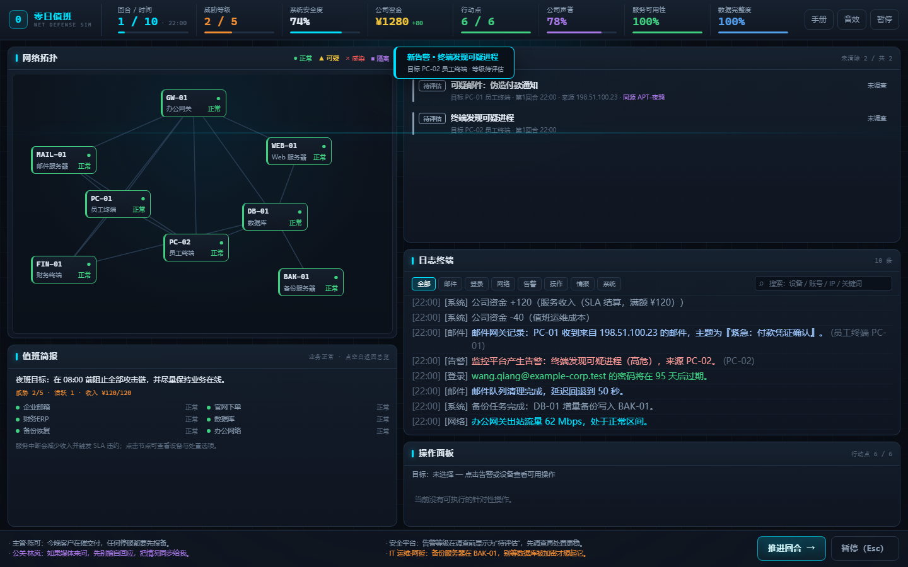

# 零日值班 · 网页版

《零日值班：网络安全防御模拟器》的浏览器版本：**原生 HTML / CSS / JavaScript，无构建步骤、无第三方依赖、无需 Python**。
规则、数据与桌面版（Pygame）一致，直接复用 `../data/*.json`。

- 在线试玩：<https://telling890.github.io/zero-day-duty/play/>
- 项目主页：<https://telling890.github.io/zero-day-duty/>
- 源码仓库：<https://github.com/telling890/zero-day-duty>
- Windows 桌面版：<https://github.com/telling890/zero-day-duty/releases/latest>




- 10 个回合、8 台虚构设备、6 条攻击链、2 个攻击战役
- 12 种操作、7 项安全加固（三线两层、第二层三选一）、2 个剧情决策、6 种结局
- 业务服务与 SLA、风险估计区间、攻击下一跳、误报、连击、情报同源
- 12 页新手教程 + 6 步实战演练
- 存档与历史排行榜（浏览器 localStorage）、可复现随机种子
- 深色 SOC 监控界面、SVG 拓扑、程序化音效、桌面 / 平板 / 手机自适应

## 一、运行

### 方式 A：直接打开（最简单）

双击 `web/index.html`。Edge / Chrome 可直接从 `file://` 运行（脚本使用经典 `<script>`，不依赖 fetch 或 ES Module）。

### 方式 B：本地静态服务器（推荐用于开发）

在 `cyber_defense_game/web` 目录下：

```powershell
py -3.10 -m http.server 8000
# 浏览器打开 http://localhost:8000/
```

也可以部署到任意静态托管（GitHub Pages、Nginx、对象存储）。

> 存档写在浏览器的 localStorage 中；`file://` 与 `http://` 属于不同来源，两边的存档互不相通。

## 二、操作

| 操作 | 方式 |
| --- | --- |
| 选择设备 | 点击左侧网络拓扑节点；点击拓扑空白返回业务总览 |
| 查看告警 | 点击右侧告警列表中的一条 |
| 调查 / 控制 / 清除 / 恢复 | 点击底部「操作面板」中的按钮（按钮上标明 AP 与资金） |
| 推进回合 | 点击「推进回合 →」或按空格 |
| 暂停 | `Esc`；暂停菜单可保存、读取、重开、回主菜单 |
| 快速保存 / 读取 | `F5` / `F9` |
| 安全加固 | `U` 或暂停菜单「安全加固」 |
| 音效开关 | `M` |
| 值班手册 | `F1` |
| 日志过滤 | 点击「全部 / 邮件 / 登录 / 网络 / 告警 / 操作 / 情报 / 系统」 |
| 日志搜索 | 在右上角搜索框输入关键词（英文、数字最稳定） |
| 移动端 | 选中告警后会自动滚到操作面板；顶栏与底栏保持吸顶 / 吸底 |

## 三、与桌面版的关系

| 项目 | 桌面版 | 网页版 |
| --- | --- | --- |
| 运行环境 | Python 3.10 + Pygame | 现代浏览器 |
| 数据 | `data/*.json` | 同一份 JSON，构建成 `js/data/game-data.js` |
| 存档 | `saves/savegame.json` / `history.json` | `localStorage`（`zdd.savegame.v1` / `zdd.history.v1`） |
| 随机数 | Python `random.Random` | 可序列化的 mulberry32（同种子在网页版内可复现） |
| 渲染 | Pygame 固定 1280×720 | DOM / SVG / CSS，自适应桌面与手机 |
| 音效 | Pygame 程序化合成 | WebAudio 程序化合成 |

规则实现与桌面版逐条对齐：指标初值、12 种操作的 AP / 资金与前置条件、三段式处置、战役节奏、风险区间、SLA 收入、结算权重与结局判定，都能在 `js/core/*.js` 中找到对应实现。

## 四、目录结构

```
web/
├── index.html                 # 页面骨架（菜单 / 值班界面 / 浮层 / 特效层）
├── css/style.css              # 深色 SOC 主题与响应式布局
├── js/
│   ├── data/game-data.js      # 由 ../data/*.json 自动生成，勿手改
│   ├── core/                  # 与 DOM 无关的游戏逻辑
│   │   ├── rng.js             # 可存档随机数
│   │   ├── models.js          # 设备 / 告警 / 事件 / 玩家状态
│   │   ├── log.js             # 日志收集、过滤、搜索
│   │   ├── services.js        # 业务服务与 SLA
│   │   ├── upgrades.js        # 加固树、前置与互斥
│   │   ├── risk.js            # 真实风险与可见区间
│   │   ├── events.js          # 事件排期、推进、战役
│   │   ├── actions.js         # 12 种操作
│   │   ├── score.js           # 结算、等级、结局、成就
│   │   ├── save.js            # localStorage 存档与历史
│   │   └── game.js            # 状态机与回合流程
│   ├── ui/
│   │   ├── topology.js        # SVG 连线 + 节点脉冲
│   │   ├── panels.js          # 指标、设备、告警、日志、操作、消息
│   │   ├── screens.js         # 菜单之外的浮层与教程
│   │   ├── effects.js         # 闪光、横幅、浮动文字、连击、反馈
│   │   └── audio.js           # WebAudio 程序化音效
│   └── main.js                # 装配、快捷键、渲染循环
├── assets/screenshots/        # 项目截图
├── tools/
│   ├── build-data.mjs         # JSON → JS 数据文件
│   ├── cdp.mjs                # 无头浏览器测试工具
│   ├── browser-smoke.mjs      # 主流程冒烟 + 截图
│   ├── browser-flow.mjs       # 教程 / 决策 / 结算 / 存档 / 移动端
│   └── browser-extra.mjs      # 购买加固 / 排行榜 / HTTP 托管
└── tests/
    └── logic.test.mjs         # 无浏览器逻辑测试（15 项）
```

## 五、数据文件

`../data/` 下的 5 个 JSON 是唯一数据源。修改后重新生成浏览器用的脚本：

```powershell
node tools/build-data.mjs
```

`js/data/game-data.js` 已提交，因此直接打开页面不需要 Node。数据校验在加载时进行（缺字段、重复 ID、引用不存在的设备等会给出明确错误）。

## 六、测试

```powershell
# 逻辑测试（Node，无需浏览器）
node tests/logic.test.mjs

# 浏览器测试（需要 Edge 或 Chrome；可用 CHROME_PATH 指定）
node tools/browser-smoke.mjs
node tools/browser-flow.mjs
node tools/browser-extra.mjs
```

- 逻辑测试覆盖：数据加载、随机排期复现、调查前后操作可用性、完整处置链、误封、SLA、加固互斥、决策、存读档往返、结算、战役揭示、风险区间收窄。
- 浏览器测试通过 DevTools Protocol 真实点击并截图，覆盖：菜单 → 简报 → 处置链 → 回合推进 → 商店 → 手册 → 暂停存读档 → 日志过滤 → 教程 12 页与实战演练 → 剧情决策 → 结算 → 刷新后读档 → 移动端布局 → HTTP 托管。截图输出到 `tests/screenshots/`。
## 七、部署到 GitHub Pages

`docs/play/` 是网页版的发布副本，由本目录同步生成（仓库里已提交）：

```powershell
node tools/sync-docs-play.mjs   # web/ → docs/play/
```

`pages.yml` 在发布前也会重新同步一次，然后把 `docs/` 作为站点根目录。推送后访问
`https://telling890.github.io/zero-day-duty/play/` 即可在线试玩；主页导航里的「在线试玩」也指向这里。
这样无论 Pages 使用「分支 /docs」还是「GitHub Actions」发布，`play/` 都存在；本地直接打开 `docs/index.html` 也能点进网页版。

其他静态托管只需要把 `web/` 目录整体上传即可。

## 八、已知限制

- 存档只保存在当前浏览器；清理站点数据、换浏览器或换设备都会丢失，也不会同步。
- 桌面版仍是规则基准；网页版重写了渲染层，像素级布局与桌面版不同。
- 音效需要一次点击 / 按键后才会响（浏览器自动播放策略）。
- 没有联网、账号、云端排行榜或真实网络功能——这是课程项目的安全边界。
- 极端窗口尺寸（低于 360px 宽）下信息密度较高，建议横屏或桌面浏览。

## 九、安全声明

本项目只做游戏模拟与课程展示：不扫描真实网络、不连接真实服务器、不执行真实系统命令、不包含真实恶意代码；所有 IP、账号、域名与服务器均为虚构数据，示例 IP 使用文档保留地址段。
