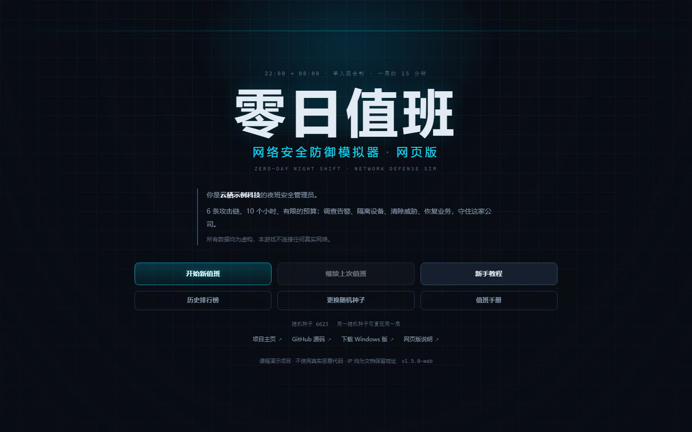
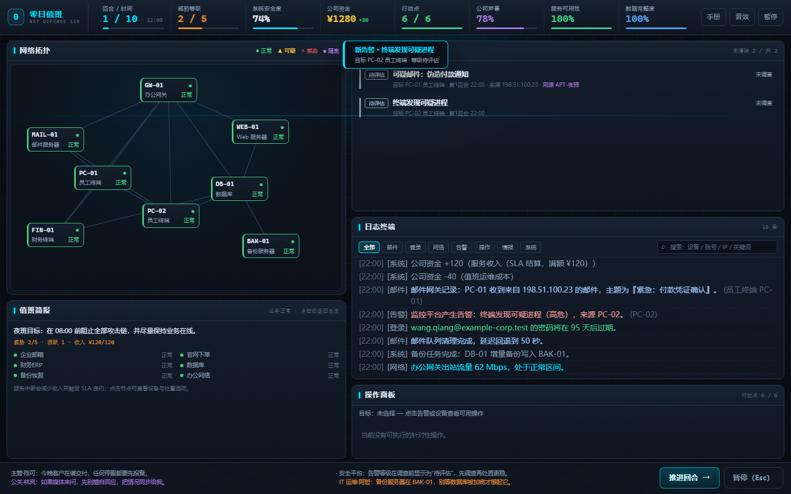

# 零日值班 · 网页版

《零日值班：网络安全防御模拟器》的浏览器版本：**原生 HTML / CSS / JavaScript，无构建步骤、无第三方依赖、无需 Python**。
规则、数据与桌面版（Pygame）一致，直接复用 `../data/*.json`。

- 在线试玩：<https://telling890.github.io/zero-day-duty/play/>
- 项目主页：<https://telling890.github.io/zero-day-duty/>
- 源码仓库：<https://github.com/telling890/zero-day-duty>
- 国内镜像：<https://gitee.com/zero-day-duty/zero-day-duty>
- Windows 桌面版：<https://github.com/telling890/zero-day-duty/releases/latest>





- 10 个回合、8 台虚构设备、6 条攻击链、2 个攻击战役
- 三档难度：新手 / 标准 / 专家；只改变信息质量、提示、误报率、日志延迟与误封代价，不直接增加攻击伤害
- 12 种操作、7 项安全加固（三线两层、第二层三选一）、3 个剧情决策（含第 5 回合三选一与 1–3 回合延迟后果）、6 种结局
- 攻击者性格：夜鸦在大量隔离时等待并留线索；灰烬偏好未打补丁资产，转向时留下探测线索
- 结算时间线：关键正确、最大失误、无效操作、误封损失、最危险被阻断攻击、打法与真实事件序列
- 可输入命令的「处置终端」：12 种处置、设备 / 告警查询、加固购买、回合推进，支持 Tab 补全与 ↑/↓ 历史
- 可写代码的「自动化剧本」：Python 风格子集，for / if / 变量 / 查询函数 + 12 种操作，带行号与语法高亮，支持运行、单步、示例与本地保存
- 业务服务与 SLA、风险估计区间、攻击下一跳、误报、连击、情报同源
- 15 页新手教程（含第一回合 6 步标准操作、核心循环图、难度/延迟决策说明、顶栏按钮、命令行终端与自动化脚本）+ 6 步沉浸式带练（聚光灯遮罩，点击 / 命令 / 脚本三条通道各用一次）
- 文件小、无外部字体 / 图片 / 音频依赖（音效全部由 WebAudio 合成）
- 存档与历史排行榜（浏览器 localStorage，含难度与时间线）、同种子 + 同难度可复现
- 深色 SOC 监控界面、SVG 拓扑、程序化音效、桌面 / 平板 / 手机自适应

## 一、运行

### 方式 A：直接打开（最简单）

双击 `web/index.html`。Edge / Chrome 可直接从 `file://` 运行（脚本使用经典 `<script>`，不依赖 fetch 或 ES Module）。

### 方式 B：本地静态服务器（推荐用于开发）

在 `cyber_defense_game/web` 目录下：

```powershell
py -3.10 -m http.server 8000
# 浏览器打开 http://localhost:8000/
```

也可以部署到任意静态托管（GitHub Pages、Nginx、对象存储）。

> 存档写在浏览器的 localStorage 中；`file://` 与 `http://` 属于不同来源，两边的存档互不相通。

## 二、操作

| 操作 | 方式 |
| --- | --- |
| 选择设备 | 点击左侧网络拓扑节点；点击拓扑空白返回业务总览 |
| 查看告警 | 点击右侧告警列表中的一条 |
| 调查 / 控制 / 清除 / 恢复 | 点击底部「操作面板」中的按钮（按钮上标明 AP 与资金） |
| 键盘执行操作 | 选中目标后按数字 1–6，直接执行操作面板里对应的按钮 |
| 处置终端 | 点顶部「终端」或按 `` ` ``；输入 `scan PC-01`、`isolate PC-01`、`clean PC-01`、`release PC-01` 等命令，Tab 补全、↑/↓ 历史、Esc 关闭 |
| 自动化剧本 | 点顶部「脚本」或按 `C`；Ctrl+Enter 运行、单步执行、Esc 关闭；脚本与手工操作共用 AP 和资金 |
| 推进回合 | 点击「推进回合 →」或按空格 |
| 暂停 | `Esc`；暂停菜单可保存、读取、重开、回主菜单 |
| 快速保存 / 读取 | `F5` / `F9` |
| 安全加固 | `U` 或暂停菜单「安全加固」 |
| 音效开关 | `M`；主菜单与顶栏都显示「音效：开 / 关」 |
| 播放测试音 | `F1` 值班手册 →「播放测试音」，或暂停菜单 →「播放测试音」 |
| 值班手册 | `F1` |
| 日志过滤 | 点击「全部 / 邮件 / 登录 / 网络 / 告警 / 操作 / 情报 / 系统」 |
| 日志搜索 | 在右上角搜索框输入关键词（英文、数字最稳定） |
| 移动端 | 选中告警后会自动滚到操作面板；顶栏与底栏保持吸顶 / 吸底 |

## 二·补、体验包（v1.7 → v1.8）：不动规则，只改“看得见的东西”

这一轮只改表现层：不新增规则、不改数值、不影响存档与随机复现，所以同一种子仍然复现同一局。

| 改动 | 之前 | 现在 |
| --- | --- | --- |
| **禁用按钮写原因** | 原因只在 `title` 里，触屏永远看不到 | 按钮第二行直接写「AP 不足（需 2，剩 1）」「请先调查告警，确认真假」 |
| **不可逆动作二次确认** | 误点「解除隔离」「关闭服务器」当场生效 | 第一次点击只把按钮变橙、显示「再点一次确认」，4 秒内不确认自动取消；换目标或推进回合也会取消 |
| **零星告警时的空态** | 告警面板下半截一大片黑 | 虚线框「监控持续运行 · 已清除 N 条 · 下一个巡检点 03:00」+ 一条扫描光 |
| **字号层次** | 提示行 10px；时间戳与正文同大 | 提示行 11px；日志正文保持 14px，时间戳 / 分类压到 12px，正文才站得出来 |
| **回合结算摘要** | 推进回合后数字直接跳变 | 左上角 1.7 秒摘要：本回合指标变化、新增告警、哪条链推进到哪一步，末尾一行「预警」写下一跳 |
| **夜色与整点** | 时钟只出现在顶栏 | 夜色随时钟走（22 点冷蓝 → 03 点最沉 → 06 点回温）；22 / 01 / 04 / 07 点各一次整点节拍与横幅 |
| **趋势预判** | 系统安全度只是一个百分比 | 按最近两回合跌幅推算，在数字下面写「约 01:00 失守」，快到期时转红 |
| **失败预兆** | 只有结算时才知道自己要死了 | 连续两回合可用性不足 40% 时，画面降饱和、右侧轻微发抖、红色暗角加频 |
| **动作音色**（v1.8） | 所有“做对了”都是同一个 `success` 音 | 调查＝键盘两声、隔离＝机械咔哒＋断电、清除＝扫频、恢复＝电流回升、封禁＝闷响、补丁＝卡扣、补备份＝低频嗡、操作未生效＝一记“不行” |
| **反馈改内联**（v1.8） | “调查成功”四个字盖在屏幕中央，正好压住日志 | 结果写在操作面板的提示行里，带色条、就地出现；粒子只炸在目标位置，不挡任何面板 |
| **损失具象**（v1.8） | 掉血只是数字变了 | 指标红 / 绿闪一下并从旧值滚到新值；业务行掉线红一下、恢复绿一下；被隔离设备的连线真的断开并打叉 |
| **误封有个人**（v1.8） | 误封只剩一句“声誉 -5” | 每台设备有业务负责人（设备详情里可见），误封时他会带着一句话来投诉，并写进日志与复盘时间线 |

夜色遮罩只在深色主题下显示；浅色主题下这些效果自动关闭，避免白底发灰。摘要与确认状态都不改变任何判定，只影响“玩家看不看得懂、敢不敢点”。

动作音色由 `js/ui/audio.js` 现场合成（WebAudio，不加载音频文件）；误封投诉的联系人写在 `data/devices.json` 的 `contact` 字段里，改文案不用改代码。

## 三、主题：跟随本机深浅色

页面用 `prefers-color-scheme` 跟随系统外观，不需要手动切换：

| 本机外观 | 界面 |
| --- | --- |
| 深色（默认） | SOC 监控中心的深夜配色：近黑底、青色霓虹、暗色面板 |
| 浅色 | 日间值班室：冷灰底、白面板、深青强调色，文字与状态色都换成满足对比度的一档 |

实现方式：`css/style.css` 开头是 token 色板（`--panel-rgb`、`--accent-rgb` 等 RGB 三元组），所有半透明色统一写成 `rgb(var(--x-rgb) / a)`；文件末尾的 `@media (prefers-color-scheme: light)` 只替换这一层 token 并补少量组件级调整。终端与自动化剧本编辑区按设计保持深色（工具窗口），靠在该子树内重设 token 实现。

改主题只需要动两处：`:root` 里的深色值、`@media (prefers-color-scheme: light)` 里的浅色值。

项目主页（`../docs/index.html`、`privacy.html`）用同一套思路但反过来：`docs/style.css` 就是浅色的「夜班事故报告」纸张肤，`docs/soc-theme.css` 整份包在 `@media (prefers-color-scheme: dark)` 里当深色覆盖层。两边占位同名 token（`--paper` / `--ink` / `--rule` / `--red` …），所以改浅色只动 `style.css` 的 `:root`，改深色只动 `soc-theme.css`。

## 四、与桌面版的关系

| 项目 | 桌面版 | 网页版 |
| --- | --- | --- |
| 运行环境 | Python 3.10 + Pygame | 现代浏览器 |
| 数据 | `data/*.json` | 同一份 JSON，构建成 `js/data/game-data.js` |
| 存档 | `saves/savegame.json` / `history.json` | `localStorage`（`zdd.savegame.v1` / `zdd.history.v1`） |
| 随机数 | Python `random.Random` | 可序列化的 mulberry32（同种子在网页版内可复现） |
| 渲染 | Pygame 固定 1280×720 | DOM / SVG / CSS，自适应桌面与手机 |
| 音效 | Pygame 程序化合成 | WebAudio 程序化合成 |

规则实现与桌面版逐条对齐：指标初值、12 种操作的 AP / 资金与前置条件、三段式处置、战役节奏、风险区间、SLA 收入、结算权重与结局判定，都能在 `js/core/*.js` 中找到对应实现。

## 五、目录结构

```
web/
├── index.html                 # 页面骨架（菜单 / 值班界面 / 浮层 / 特效层）
├── css/style.css              # 深色 SOC 主题与响应式布局
├── js/
│   ├── data/game-data.js      # 由 ../data/*.json 自动生成，勿手改
│   ├── core/                  # 与 DOM 无关的游戏逻辑
│   │   ├── rng.js             # 可存档随机数
│   │   ├── models.js          # 设备 / 告警 / 事件 / 玩家状态
│   │   ├── log.js             # 日志收集、过滤、搜索
│   │   ├── services.js        # 业务服务与 SLA
│   │   ├── upgrades.js        # 加固树、前置与互斥
│   │   ├── risk.js            # 真实风险与可见区间
│   │   ├── events.js          # 事件排期、推进、战役
│   │   ├── actions.js         # 12 种操作
│   │   ├── score.js           # 结算、等级、结局、成就
│   │   ├── save.js            # localStorage 存档与历史
│   │   ├── difficulty.js      # 三档难度配置（与桌面版共用 JSON）
│   │   ├── game.js            # 状态机与回合流程
│   │   └── zscript.js         # 自动化剧本解释器（Python 风格子集）
│   ├── ui/
│   │   ├── topology.js        # SVG 连线 + 节点脉冲
│   │   ├── panels.js          # 指标、设备、告警、日志、操作、消息
│   │   ├── screens.js         # 菜单之外的浮层与教程
│   │   ├── terminal.js        # 可输入命令的处置终端（映射到同一套操作）
│   │   ├── script.js          # 自动化剧本编辑器 / 运行器
│   │   ├── effects.js         # 闪光、横幅、浮动文字、连击、反馈
│   │   └── audio.js           # WebAudio 程序化音效
│   └── main.js                # 装配、快捷键、渲染循环
├── assets/screenshots/        # 项目截图
├── tools/
│   ├── build-data.mjs         # JSON → JS 数据文件
│   ├── cdp.mjs                # 无头浏览器测试工具
│   ├── browser-smoke.mjs      # 主流程冒烟 + 截图
│   ├── browser-terminal.mjs   # 处置终端测试
│   ├── browser-script.mjs     # 自动化剧本 + 信息隔离测试
│   ├── browser-depth.mjs      # 难度 / 延迟决策 / 结算时间线
│   ├── browser-flow.mjs       # 教程 / 决策 / 结算 / 存档 / 移动端
│   ├── browser-extra.mjs      # 购买加固 / 排行榜 / HTTP 托管
│   └── browser-audio.mjs      # WebAudio 波形与静音测试
└── tests/
    ├── logic.test.mjs         # 无浏览器逻辑测试（22 项）
    └── zscript.test.mjs       # 剧本解释器单元测试
```

## 六、数据文件

`../data/` 下的 5 个 JSON 是唯一数据源。修改后重新生成浏览器用的脚本：

```powershell
node tools/build-data.mjs
```

`js/data/game-data.js` 已提交，因此直接打开页面不需要 Node。数据校验在加载时进行（缺字段、重复 ID、引用不存在的设备等会给出明确错误）。

## 七、测试

```powershell
# 逻辑测试（Node，无需浏览器）
node tests/logic.test.mjs
node tests/zscript.test.mjs

# 浏览器测试（需要 Edge 或 Chrome；可用 CHROME_PATH 指定）
node tools/browser-smoke.mjs
node tools/browser-terminal.mjs
node tools/browser-script.mjs
node tools/browser-depth.mjs
node tools/browser-flow.mjs
node tools/browser-extra.mjs
node tools/browser-audio.mjs
node tools/browser-theme.mjs
node tools/browser-feel.mjs          # 体验包 A+B：禁用理由 / 二次确认 / 结算摘要 / 夜色 / 预判
node tools/browser-docs-theme.mjs   # 项目主页 docs/ 的深浅色

# 想在「本机浅色」外观下跑上面任一浏览器测试，先设环境变量：
#   PowerShell:  $env:ZDD_COLOR_SCHEME = 'light'
#   bash:        ZDD_COLOR_SCHEME=light node tools/browser-flow.mjs
# 夜色遮罩只在深色主题下生效，想看它请用 'dark'。
```

- 体验包测试覆盖：零星告警时的值守空态、禁用按钮把原因写在按钮上（触屏无 hover 也可见）、关闭服务器 / 解除隔离的两步确认、日志正文与时间戳的字号层次、回合结算摘要的出现与 1.7 秒自动收起、夜色遮罩（深色生效 / 浅色关闭）、安全度趋势预判、连续低可用性的失败预兆、手机宽度下的可用性；截图输出到 `tests/screenshots/feel/`。
- 主题测试覆盖：深浅两套外观下的页面底色、面板渐变、顶栏、弹窗与终端（终端按设计保持深色），以及正文 / 弹窗文字对比度 ≥ 7；截图输出到 `tests/screenshots/theme/`。
- 主页主题测试覆盖：`docs/index.html`（纸张米白 ↔ SOC 深色）与 `docs/privacy.html` 在两种外观下的底色、强调色、正文与链接配色，另检查试玩区进度条在浅色下也有样式；截图输出到 `tests/screenshots/docs-theme/`。

- 逻辑测试覆盖：数据加载、随机排期复现、调查前后操作可用性、完整处置链、误封、SLA、加固互斥、三档难度信息质量、隐藏/延迟决策、三选一、存读档与旧存档兼容、结算时间线、攻击者等待、风险区间收窄。
- 剧本解释器测试覆盖：变量、if/elif/else、for/while、break/continue、列表与索引、比较与 in、属性访问、内置查询与操作调用、语法错误行号、步数上限。
- 浏览器测试通过 DevTools Protocol 真实点击并截图，覆盖：菜单 → 简报 → 处置链 → 回合推进 → 商店 → 手册 → 暂停存读档 → 日志过滤 → 教程 15 页与实战演练 → 剧情决策 → 结算 → 刷新后读档 → 移动端布局 → HTTP 托管 → WebAudio 波形与静音。
- 难度与时间线测试覆盖：三档难度选择、专家模式信息质量、隐藏成本提示、三选一决策、延迟队列、结算关键复盘与真实时间线。
- 处置终端测试覆盖：` 热键、Tab 补全、↑ 历史、scan/isolate/clean/release/next、未知命令提示、Esc 关闭、数字键执行操作、手机端全屏与紧凑表格。截图输出到 `tests/screenshots/`。
- 自动化剧本测试覆盖：脚本面板、默认模板、运行调查/隔离/清除/解除隔离、单步执行、语法错误提示、本地保存、手机布局，以及未调查告警/事件不可读取的信息隔离。

### 听不到声音时

1. 先点一次页面（浏览器要求一次手势才能播放音频），再点「播放测试音」。
2. 看主菜单或顶栏是否显示「音效：关」——按 `M` 或点击开关重新打开。
3. 检查系统音量、浏览器标签页是否被静音、以及是否在静音/无音频权限的 iframe 预览中；直接在浏览器新标签页打开 `play/index.html` 最稳。
## 八、部署到 GitHub Pages

`docs/play/` 是网页版的发布副本，由本目录同步生成（仓库里已提交）：

```powershell
node tools/sync-docs-play.mjs   # web/ → docs/play/
```

`pages.yml` 在发布前也会重新同步一次，然后把 `docs/` 作为站点根目录。推送后访问
`https://telling890.github.io/zero-day-duty/play/` 即可在线试玩；主页导航里的「在线试玩」也指向这里。
这样无论 Pages 使用「分支 /docs」还是「GitHub Actions」发布，`play/` 都存在；本地直接打开 `docs/index.html` 也能点进网页版。

其他静态托管只需要把 `web/` 目录整体上传即可。

## 九、已知限制

- 存档只保存在当前浏览器；清理站点数据、换浏览器或换设备都会丢失，也不会同步。
- 桌面版仍是规则基准；网页版重写了渲染层，像素级布局与桌面版不同。
- 音效需要一次点击 / 按键后才会响（浏览器自动播放策略）。
- 没有联网、账号、云端排行榜或真实网络功能——这是课程项目的安全边界。
- 自动化剧本是内置的 Python 风格子集：支持变量、if/for/while、列表与属性访问；暂不支持 def / import / 文件或网络操作，只调用游戏内的 12 种操作。
- 极端窗口尺寸（低于 360px 宽）下信息密度较高，建议横屏或桌面浏览。

## 十、安全声明

本项目只做游戏模拟与课程展示：不扫描真实网络、不连接真实服务器、不执行真实系统命令、不包含真实恶意代码；所有 IP、账号、域名与服务器均为虚构数据，示例 IP 使用文档保留地址段。
